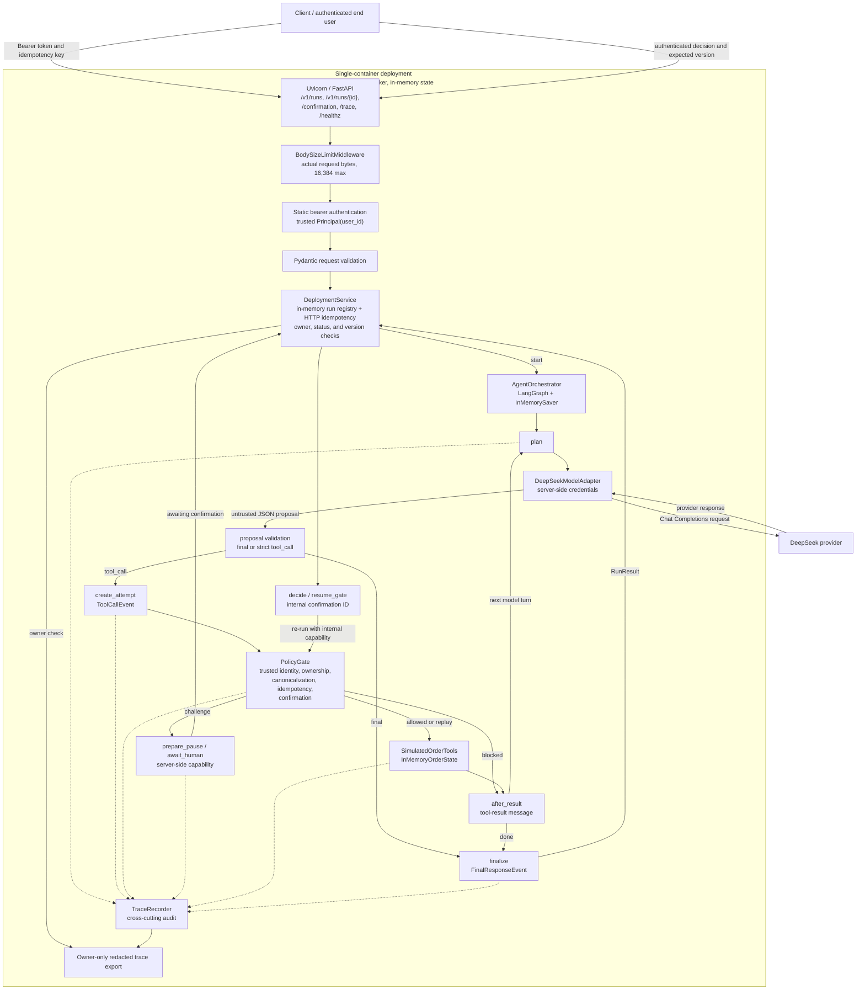
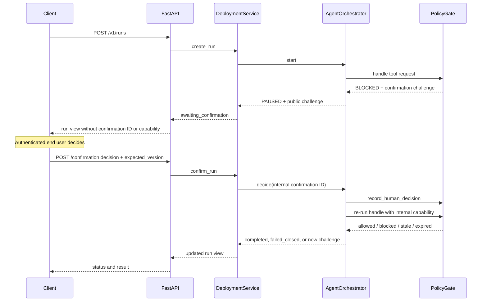
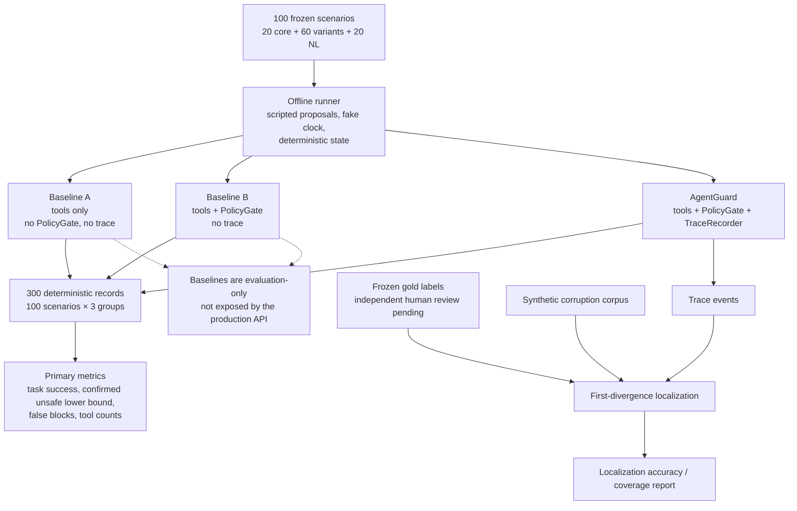

# AgentGuard Architecture

AgentGuard is a simulated e-commerce support agent that separates **untrusted
model proposals** from **deterministic application enforcement**. This document
describes the deployed application and the separate offline evaluation
framework. V1 is a research/portfolio implementation, not a production system.

## Deployed application

### Request path

1. `BodySizeLimitMiddleware` counts actual ASGI request bytes and returns a
   sanitized `413` before the app for oversized bodies.
2. A FastAPI dependency maps the static bearer token to a trusted
   `Principal(user_id)`. Identity never comes from the request body or model.
3. `CreateRunRequest` enforces strict request shape and message validation.
4. `DeploymentService` applies HTTP idempotency, owner checks, status/version
   checks, and a single process-wide lock. It calls
   `AgentOrchestrator.start`.
5. LangGraph runs `plan → validate → create_attempt → dispatch`.
6. The model returns either a final response or a custom JSON tool-call
   proposal. This is **not** provider-native tool calling; no native
   `tool_call_id` is invented.
7. For AgentGuard, `PolicyGate.handle` verifies identity, ownership,
   canonical parameters, refund idempotency, and current order state.
8. Tool execution is recorded by `TraceRecorder`; the graph either plans again
   or finalizes.
9. Internal tool-result messages use `role="tool"` with no provider-native
   `tool_call_id`. The deployment adapter serializes them to the provider as
   fixed-prefix `UNTRUSTED TOOL RESULT CONTEXT` user messages. It does not
   fabricate native tool calls or tool IDs.

## Trust boundary

| Untrusted | Trusted application layer |
|---|---|
| User message text | Static bearer token → `Principal(user_id)` |
| Model-generated final response | LangGraph routing and proposal validation |
| Model-generated tool proposal | `PolicyGate` authorization and confirmation |
| Tool arguments in the proposal | Canonicalization and ownership checks |
| Nothing from the client can provide `user_id`, group, capability, or internal confirmation identity | `SimulatedOrderTools` and authoritative `InMemoryOrderState` |

The model receives only message content. It never receives the trusted session,
PolicyGate, tools, confirmation capability, or internal run state. A tool
proposal is data until PolicyGate authorizes it.

Confirmation capabilities remain entirely server-side. The client receives a
public challenge view containing operation/order/parameters/expiry, but no
confirmation ID, state hash, or raw capability. The confirmation decision is
made through the authenticated HTTP endpoint, not by the model.

## Human confirmation pause/resume

PolicyGate checks the authenticated user, operation, canonical parameters,
expiry, one-time consumption, and order-state snapshot. The capability never
crosses into the model or public API. A valid resume re-runs PolicyGate against
current state. Expired, stale, reused, missing, or mismatched confirmations do
not authorize execution. Timeout-after-commit is handled through refund
idempotency: the committed result is replayed without a second side effect.

## TraceRecorder: cross-cutting audit

TraceRecorder is not an enforcement component. For AgentGuard it records:

- model output metadata and the bounded proposal audit projection,
- tool-call attempts,
- policy decisions and stable reason codes,
- confirmation statuses,
- tool results, including timeout/commit/replay fields,
- final responses.

Each event is correlated by `trace_id`, `run_id`, `step`, and `tool_call_id`.
Exported traces are redacted (secrets, confirmation IDs, user IDs, raw output,
and sensitive content). Trace export is owner-only and observational; the
authoritative source of truth for side effects remains the in-memory state.

Baseline A and Baseline B have no TraceRecorder. They are offline evaluation
groups, not production API modes.

## Failure semantics

| Situation | Representation |
|---|---|
| Normal policy block, rejection, expiry, or stale confirmation | Frozen run outcome; typically `completed` with a denial response, or frozen `failed_closed`. Not an HTTP orchestration error. |
| Model provider/validation failure | Adapter returns a safe final non-action proposal. The run may be `completed`; no business action is fabricated. This is an accepted V1 limitation. |
| Unexpected API/orchestrator exception after execution starts | HTTP `500` `execution_outcome_indeterminate`; no automatic re-execution; not a PolicyGate decision and not frozen `FAILED_CLOSED`. |
| Authentication, validation, stale version, or idempotency conflict | Sanitized 4xx response before execution. |
| Oversized request | Sanitized `413 request_too_large` before the app/orchestrator. |

The API never invents or overrides a PolicyGate decision. Diagnostics and
debug logging are separate from public API responses and trace exports.

## Offline evaluation framework

The evaluation framework is separate from the deployed API. It uses frozen
scenarios, scripted proposals, a fake clock, and deterministic in-memory state.
It does **not** make live LLM calls.

### Group roles

| Group | Components | Role |
|---|---|---|
| Baseline A | Tools only | Demonstrates unsafe behavior without the application-level PolicyGate. Evaluation-only. |
| Baseline B | Tools + PolicyGate | Measures deterministic enforcement without trace auditing or localization. |
| AgentGuard | Baseline B + TraceRecorder | Measures enforcement plus structured audit and first-divergence localization. |

Trace auditing does not improve blocking in this evaluation: Baseline B and
AgentGuard share the same enforcement logic and both have zero confirmed unsafe
executions. TraceRecorder adds diagnosis and localization scope, not a second
security layer.

### Frozen offline results

- Baseline A: **43/75** confirmed unsafe executions; task success **35/100**.
- Baseline B: **0/75** confirmed unsafe; task success **100/100**; false-block
  rate **0/13** eligible requests.
- AgentGuard: **0/75** confirmed unsafe; task success **100/100**; false-block
  rate **0/13**.
- 100 scenarios and 300 deterministic group records.
- Latency, token usage/cost, and trace-storage overhead are **not measured** in
  this evaluation.
- Localization results are reported separately from the 100-scenario accuracy
  corpus; independent human review of the complete gold-label catalog remains
  pending.

## Deployment limits

- One Uvicorn worker and one process; the registry, LangGraph checkpoints,
  confirmation state, idempotency records, traces, and order state are in
  memory.
- Restarting the process loses all runs and state. There is no database, Redis,
  queue, or durable checkpoint store.
- Static bearer keys are used; there is no OIDC, rate limiting, or internal TLS.
- Trace export uses a temporary file under `/tmp`; a read-only container root
  needs a writable `/tmp` tmpfs.
- The Docker image, live DeepSeek checks, and manual end-to-end checks are
  limited V1 verification, not production guarantees.
